<p align="center">
  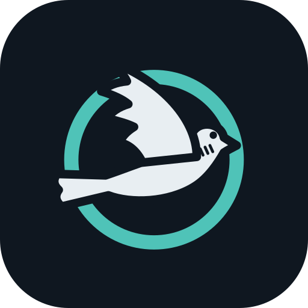
</p>

<h1 align="center">Turtur</h1>

<p align="center">
  <b>Camp mail that flies in pockets.</b><br>
  Offline, end-to-end sealed messaging for festivals, trekkers, and hikers.
</p>

<p align="center">
  
  
  
  
  
</p>

---

*Turtur* is Latin for the turtle dove (*Streptopelia turtur*). There is no chat server. Your phone is a **loft**. The other phones in your **trip flock** are the coops a pigeon can land in. A sealed letter moves when people physically come into Bluetooth range: at camp, a hut kitchen, a trailhead, or a festival meeting point.

Turtur is built for the moments when WhatsApp has no tower.

<p align="center">
  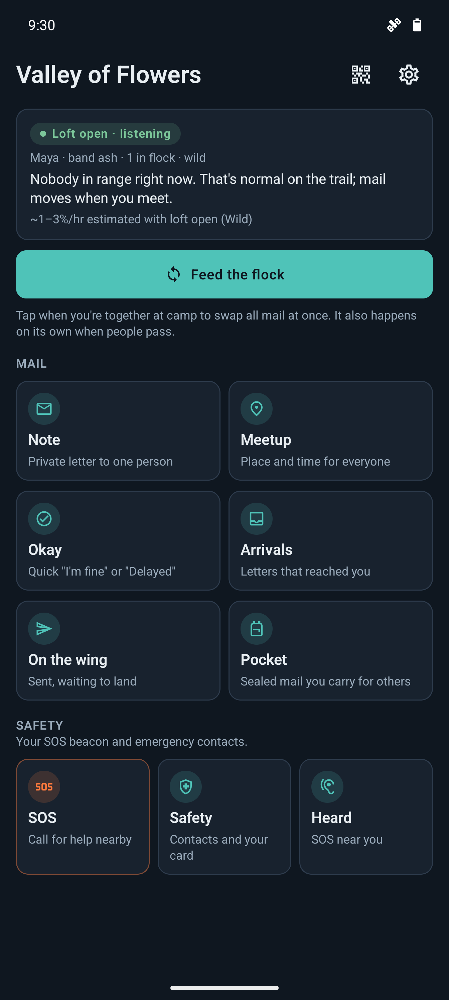
  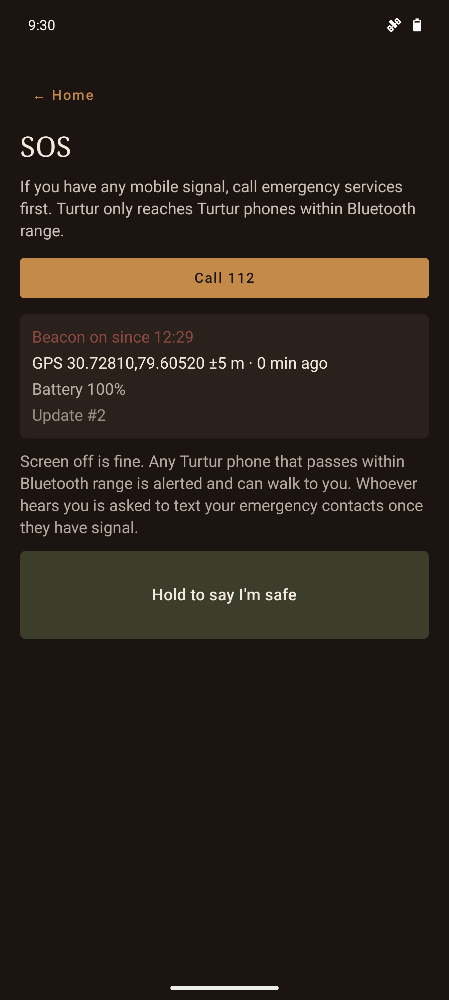
  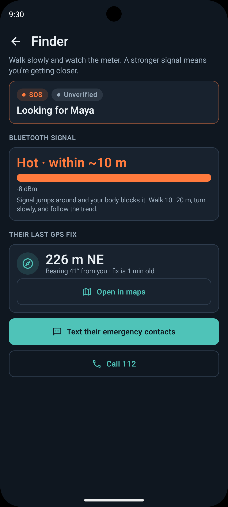
</p>

<p align="center">
  <a href="dist/turtur-0.1.0.apk"><b>Download the APK</b></a> · Android 8.0+ · <a href="#install-the-apk">install notes</a> · <a href="#screenshots">more screenshots</a>
</p>

## How a letter travels

Alex writes to Chris. They never stand near each other, but Blair passes both of them during the day.

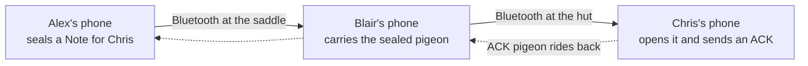

Blair's phone carries the letter but cannot read it. Only Chris's keys open it.

## Who it is for

- Festival crews that split across stages and reunite at camp
- Hut-to-hut trekkers who can wait until evening for news
- Weekend hikers who miss a junction or straggle back to the car

## Features

**Trips and identity**
- Start or join a **trip** by scanning a flock QR or pasting an invite. No phone numbers and no accounts.
- Any member can show the QR to late joiners. Flocks are capped at 12 lofts.
- Membership spreads by **signed roster gossip**, so mid-trip joiners learn everyone's keys as they meet people.

**Messages**
- **Note**: up to 500 characters, sealed for one person.
- **Meetup**: a place and a local time, sent to the whole flock.
- **Okay**: *I'm fine*, *Delayed*, or *Stay put*, two taps away.
- Pick how long each pigeon lives: the habitat default, or 4h, 24h, or 72h.

**Delivery**
- **Store-and-forward**: flock members carry sealed pigeons for each other until they reach the recipient or expire.
- **Feed the flock**: a burst sync when you sit down together. It reports who was nearby and how many pigeons moved.
- **Opportunistic sync**: a quiet background scan hands mail over when a flock member walks past, without tapping anything.
- A **foreground loft service** keeps Bluetooth working with the screen off, so a phone in a pocket can still carry mail.
- Honest status: *on the wing*, *landed* (after an ACK comes back), or *returned* (the pigeon expired before it landed). There are no fake read receipts.

**On the phone**
- **Arrival notifications** that keep content off the lock screen, plus a haptic on Feed.
- **Pocket flock**: see the sealed pigeons you are carrying for others and set any of them down.
- **Wild / Crowd habitat**: slow, battery-friendly radio for trails, or faster radio for festivals.
- **End trip** wipes this phone's keys, roster, and mail.

**SOS beacon (best effort)**
- **Hold SOS for 3 seconds** and the phone becomes a slow, battery-friendly Bluetooth beacon. It works with or without a trip and carries your name, a signed GPS fix (refreshed every 10 minutes), battery level, and up to three emergency contact numbers. The SOS screen always offers **Call 112** first.
- **Trip members** get the SOS as a top-priority pigeon through normal store-and-forward, and their phones also hear the beacon directly.
- **Good Samaritan** (opt in, in Safety): any Turtur phone, from any trip, gets a loud alert when an SOS beacon is in Bluetooth range, even with Turtur closed.
- **Finder**: a hot/cold signal meter plus distance and bearing from your GPS to the hiker's last fix.
- **SMS bridge**: whoever heard the SOS is reminded to text the hiker's contacts, and nudged again when mobile signal comes back. The message is prefilled with the location and a map link, and they tap Send in their own SMS app. There is still no server.
- **Guardian cards**: swap QR cards with hiking partners so their SOS shows as *verified* on your phone. A stranger's SOS is shown as *unverified*.
- **Hold to say I'm safe** broadcasts a signed cancel for 30 minutes, then stops.

## Security model in one paragraph

Each loft creates its own X25519 sealing key and Ed25519 signing key when it starts or joins a trip. Every pigeon is a sealed box to one recipient: an ephemeral X25519 exchange, HKDF-SHA256, then ChaCha20-Poly1305, with plaintext padded into fixed size bins. Inner payloads and roster updates are signed. Carriers can see envelope metadata (trip, destination loft, expiry, priority) but not content. Keys live in Android `EncryptedSharedPreferences`.

The SOS beacon uses a separate, long-lived Ed25519 key that survives **End trip**. SOS records are signed but **not** encrypted, because strangers need the position to find you.

Turtur is **not** a replacement for 112, a personal locator beacon, or satellite SOS. The SOS beacon reaches **only Turtur phones within Bluetooth range** (tens of metres, a few hundred on phones with long-range Bluetooth), and it never reaches phones without Turtur. Mail can be late or never land. Read [`flaw.md`](flaw.md) before relying on it.

## Screenshots

Trips and safety setup:

<table>
  <tr>
    <td align="center">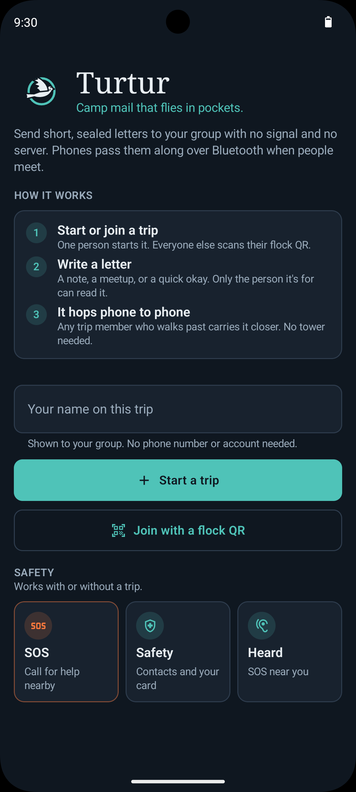<br><sub>Gate: start or join a trip. SOS works without one.</sub></td>
    <td align="center"><br><sub>Trip home with the SOS row</sub></td>
    <td align="center">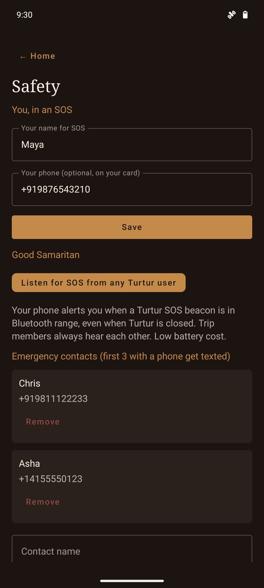<br><sub>Safety: SOS name, Good Samaritan, contacts</sub></td>
    <td align="center">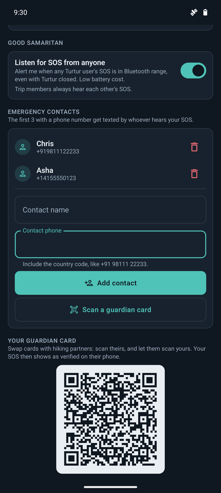<br><sub>Your guardian card QR</sub></td>
  </tr>
</table>

The hiker who needs help:

<table>
  <tr>
    <td align="center">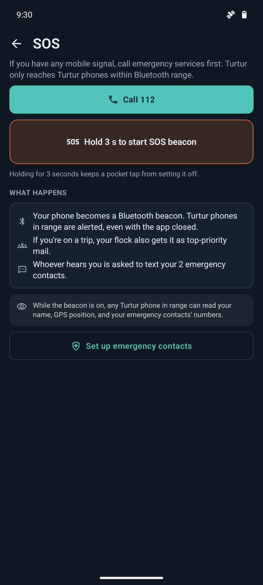<br><sub>Call 112 first, or hold 3 s for the beacon</sub></td>
    <td align="center"><br><sub>Beacon on with a signed GPS fix</sub></td>
  </tr>
</table>

The Turtur user who walks past:

<table>
  <tr>
    <td align="center">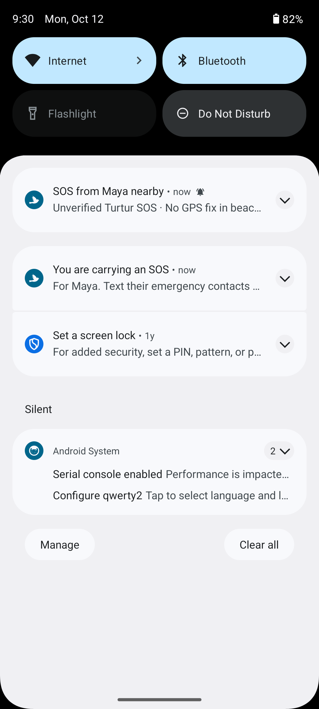<br><sub>Loud alert, plus a reminder to text contacts</sub></td>
    <td align="center">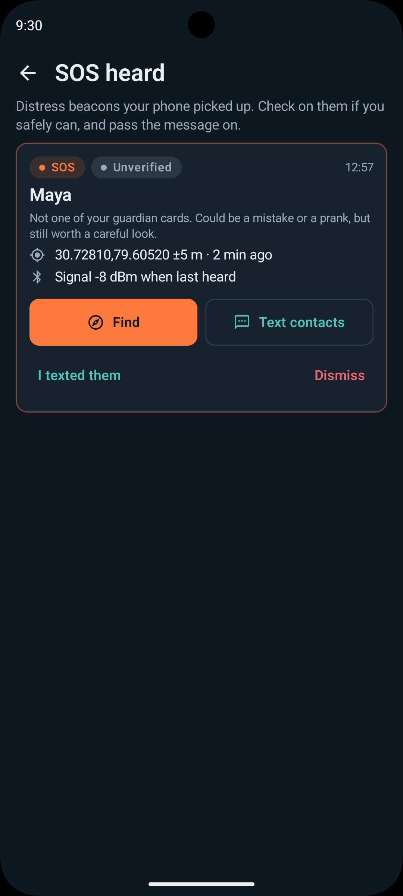<br><sub>Heard: every SOS this phone picked up</sub></td>
    <td align="center"><br><sub>Finder: hot/cold signal and distance/bearing</sub></td>
    <td align="center">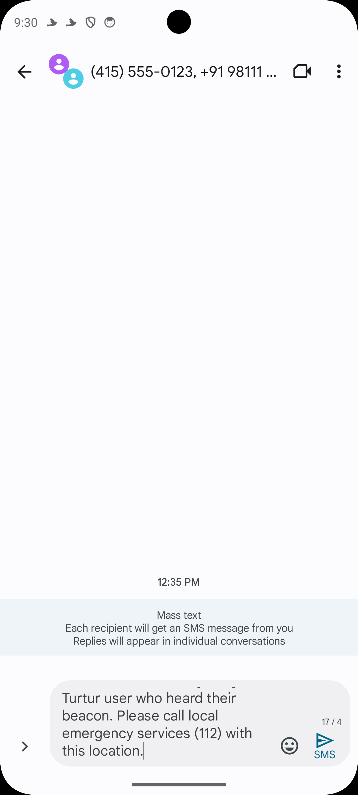<br><sub>SMS bridge: prefilled text to the hiker's contacts</sub></td>
  </tr>
</table>

These were captured on two Android 15 emulators with simulated Bluetooth. The signal strength in the Finder is virtual, and the phone numbers and location are made up.

## Install the APK

[`dist/turtur-0.1.0.apk`](dist/turtur-0.1.0.apk) is a **debug build** (version 0.1.0, about 24 MB) for Android 8.0 or newer.

SHA-256: `7d286ab56542b095a5a183d08abd1f7a10f55c3fe04500d34c6bbf23cf20f820`

1. Copy the APK to the phone, or install it from a computer with `adb install dist/turtur-0.1.0.apk`.
2. When Android asks, allow your file manager or browser to install unknown apps.
3. On first launch, allow Bluetooth and notifications. Allow location when you set up SOS so the beacon can include a GPS fix.

The debug build is signed with a local debug key, so it won't update over a Play Store or release build of Turtur. Uninstall first if Android reports a signature conflict. To build your own, see the next section.

## Getting started

You need Android Studio with JDK 17, plus two or more Android phones with Bluetooth LE (Android 8.0 or newer). To skip the build, install the [prebuilt APK](#install-the-apk) on each phone.

```
./gradlew :app:assembleDebug   # build the debug APK
./gradlew :app:test            # run the unit tests
```

Try the three-phone demo:

1. Phone A taps **Start a trip**. Phones B and C scan A's flock QR.
2. Grant Bluetooth and notification permissions. Each phone shows a "Turtur loft open" notification.
3. Put all three phones in airplane mode with Bluetooth turned back on.
4. Keep A and C apart. A sends C a Note.
5. Bring B near A, then near C, and tap **Feed the flock** each time (or just wait for the background sync).
6. C gets the letter, and A eventually sees it marked *landed*.

Try the SOS beacon with two phones (no trip needed):

1. On both phones open **Safety**, save a name, and scan each other's guardian card. On phone B turn on **Listen for SOS from any Turtur user**.
2. On phone A add an emergency contact with a phone number, allow location, then hold **SOS** for 3 seconds.
3. Phone B rings with "SOS from A nearby". Tap it to open the finder and walk around to watch the meter.
4. On B tap **Text contacts**: the SMS app opens with A's location prefilled.
5. On A hold **I'm safe**. B shows "A says they are safe".

## Project layout

```
app/src/main/java/dev/turtur/
├── LoftRuntime.kt / LoftService.kt   process-wide loft and the foreground BLE service
├── crypto/      sealed boxes, signatures, padding
├── flock/       FlockEngine: trips, pigeons, roster, TTL, ACKs
├── radio/       BLE advertise, scan, GATT sync protocol, SOS beacon and listener
├── sos/         SOS records, guardian cards, beacon service, alerts, SMS bridge
├── invite/      flock QR encode and decode
├── notify/      arrival notifications and haptics
├── store/       on-device storage (trip store and the guardian store)
├── model/       data types
└── ui/          Jetpack Compose screens

dist/                prebuilt debug APK
docs/screenshots/    README screenshots
```

## Docs

| File | What's in it |
| --- | --- |
| [`discussion.md`](discussion.md) | Locked MVP decisions and the reasons behind them |
| [`flow.md`](flow.md) | Screens and user flows |
| [`flaw.md`](flaw.md) | Threat model, limits, and in-app warnings |
| [`futureimplementation.md`](futureimplementation.md) | Roadmap: grounds, paper QR pigeons, courier mode, iOS |

## Vocabulary

| Word | Meaning |
| --- | --- |
| Loft | This phone's trip identity and keys |
| Flock / trip | The bonded group, up to 12 lofts |
| Pigeon | One sealed packet in transit |
| On the wing | Sent but not confirmed landed |
| Pocket | Sealed pigeons you carry for others |
| Arrivals | Mail that opened on this phone |
| Feed the flock | Sync with phones in range right now |
| Molt | End the trip and wipe this phone |

## The logo

The mark is a turtle dove, with the striped neck patch that gives the species away, flying through a copper **leg band**. Homing pigeons wear bands that say which loft they belong to. In Turtur, the band is your loft identity, and the dove is the letter finding its way home.

| Ink | Paper | Copper | Moss |
| --- | --- | --- | --- |
| `#1C1410` | `#F3EBDD` | `#C48A4A` | `#7A8A62` |

The source artwork is [`assets/turtur-icon.svg`](assets/turtur-icon.svg). On Android it ships as an adaptive launcher icon with a themed monochrome layer and a matching status-bar silhouette.
